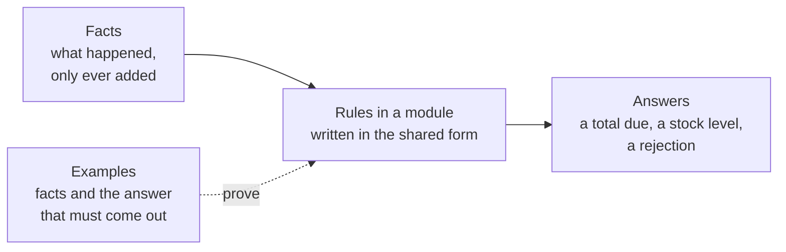

# Uniti Standard

The Uniti Standard is a **shared way to record what an organization knows**:
what happened, what is true, and how its numbers are worked out. Content made
by one person can be used together with content made by another, in any
domain, without the two knowing each other and without conflict.

Uniti is the project that wrote this standard. The standard is a set of
written documents, not a product you install.

> **Status: version 0.1.0, locked.** This first version is complete: nothing
> more is added to it. Until it is declared stable, it changes only to fix a
> real problem found while building the first system, such as text that can be
> read two ways. Every fix gets its own
> [decision record](decisions/0052-quick-test-then-lock.md) and an entry in the
> [change log](CHANGELOG.md).

## The problem

Every organization, whether a shop, a clinic, a school, or a community, keeps
two things: **facts** (what happened) and **logic** (how its numbers are
worked out). In most systems the two are mixed inside the code and tables of
one builder. So:

- parts made by different people are hard to combine;
- old data breaks when the system changes;
- the organization's knowledge is locked inside one piece of software.

The Uniti Standard separates facts from logic and gives both one shared form.

## The idea, in a small story

Alex rents out tents.

- **Only facts are recorded.** "The tent costs 50,000 IDR a day." "Rental r1
  takes the tent from 6 to 9 October." Each fact keeps two times: when it is
  true, and when it was recorded.
- **Numbers are worked out, not typed in.** The total due of r1 is not
  recorded. A written rule works it out: the daily rate times the number of
  days, 150,000 IDR.
- **Nothing is erased.** On 20 October, Alex records that the rate rises to
  60,000 IDR from 1 November: recorded on one day, true from another. This
  new fact replaces the old one, and the old one stays. The October rental
  still comes to 150,000 IDR, and anyone can see what was known on any day.
  It works like an accountant's ledger: a mistake is fixed by a new entry,
  never by rubbing out the old one.
- **Rules can say no.** A rule "one tent is not rented twice on the same day"
  rejects a second rental that overlaps the first, with a message that says
  why.
- **Every rule proves itself.** Each rule carries examples: some facts and the
  answer that must come out. A machine runs them, so a rule is accepted only
  when its examples pass.
- **Others build on it safely.** Alex keeps these rules together in a
  package called a **module**, `alex/rental`, published in numbered versions
  that never change once published. A camping shop uses version 1. When
  Alex publishes version 2, the shop is not affected until it chooses to
  move.

The same ideas, explained in plain words, are in the
[introduction](guide/introduction.md); the same story in the real notation
is the [tour](guide/tour.md).



## What it is, and what it is not

The standard has two parts:

| Part | Contents | Nature |
|---|---|---|
| **A. Form** ([`form/`](form/01-facts.md)) | The way to record anything: facts, addresses, values, concepts, relations, calculation rules, change, and proof | **Fixed.** The same for all domains. New rules may be added later; existing ones never change |
| **B. Content** ([`content/`](content/README.md)) | Ready-made shared material: the first shared words (such as party, item, payment), templates for writing cards, lists of standard codes such as currencies, and ready-made calculations | **Flexible.** Keeps growing |

An analogy: the form is the **grammar**, the shared vocabulary is the
**words**, and each organization's module is a **story** written with that
grammar and those words ([`00-principles.md`](00-principles.md) §3).

It is **not**:

- **software.** Any software may follow it, including Uniti's own. When
  software and the standard differ, the standard is right.
- **a database or a file format.** Facts may be stored in any way. A machine
  format for exchange is postponed
  ([`decisions/0055`](decisions/0055-locked-in-english.md)).
- **a programming language.** Rules are written with a small set of
  operations that the form defines. If a field needs a new way of
  calculating, it is added to a shared library of calculations, and the form
  stays small
  ([`decisions/0045`](decisions/0045-core-operations-and-calculation-library.md)).
- **finished content for every domain.** It brings the first shared words;
  each organization writes the rest in its own modules.

## Start here

| You want to | Read |
|---|---|
| **Understand the idea** | [`guide/introduction.md`](guide/introduction.md), the standard in plain words, then the [tour](guide/tour.md): one small story through every part |
| **Get a map** of the whole standard | [`guide/overview.md`](guide/overview.md) |
| **Build software** that follows the standard | [`guide/implementing.md`](guide/implementing.md), which leads to the form documents and the [conformance tests](conformance/README.md) |
| **Write content**: a module or a vocabulary | [`00-principles.md`](00-principles.md), then [`content/README.md`](content/README.md) and [`content/card-templates.md`](content/card-templates.md); the notation is in [`appendix/A-notation.md`](appendix/A-notation.md) |
| **Look up** a rule or a term | [`rules.md`](rules.md), every rule by ID; [`01-glossary.md`](01-glossary.md), every term |
| **Know why** something is as it is | [`decisions/`](decisions/README.md), one decision per file, with the alternatives that were rejected |
| **Propose a change** | [`GOVERNANCE.md`](GOVERNANCE.md), then [`CONTRIBUTING.md`](CONTRIBUTING.md) |
| **Work here as a code agent** | [`AGENTS.md`](AGENTS.md) |

To read the standard itself, start at [`00-principles.md`](00-principles.md).
Each document links to the next one at the top, in this order: `00` → `01` →
`form/01` to `form/08` → `appendix/A` → `content/`.

---

The rest of this page is a reference for people who will work with the
standard itself. If you only want to understand the idea, the
[introduction](guide/introduction.md) is the next step.

## What is normative

"Normative" means: this is the standard itself, and software is measured
against it. Everything else helps you read and use it.

| Normative: this is the standard | Not normative: this helps you read and use it |
|---|---|
| [`00-principles.md`](00-principles.md) | [`guide/`](guide/overview.md): the introduction, the tour, the overview, the implementer guide |
| [`01-glossary.md`](01-glossary.md) | [`rules.md`](rules.md): an index made from the text |
| [`form/`](form/01-facts.md): part A | [`decisions/`](decisions/README.md): the reasons |
| [`appendix/A-notation.md`](appendix/A-notation.md): the reference notation | [`reference/`](reference/README.md): the reference calculator, a program for comparison |
| [`content/`](content/README.md): part B | This page, [`CONTRIBUTING.md`](CONTRIBUTING.md), [`GOVERNANCE.md`](GOVERNANCE.md), [`ROADMAP.md`](ROADMAP.md), [`CHANGELOG.md`](CHANGELOG.md) |
| The examples in [`conformance/`](conformance/README.md): the conformance tests of [`form/08-proof.md`](form/08-proof.md) §2.9 | |

When a guide or an index differs from the normative text, the normative text
is right, and the guide is what must be fixed.

## Map of the repository

| Place | Contents |
|---|---|
| [`00-principles.md`](00-principles.md) | Purpose, scope, the three layers, the principles, requirement keywords, conformance |
| [`01-glossary.md`](01-glossary.md) | The one meaning of every term |
| [`form/01-facts.md`](form/01-facts.md) | The form of one fact, and reading facts at two times |
| [`form/02-addresses.md`](form/02-addresses.md) | Unique and permanent addresses |
| [`form/03-values.md`](form/03-values.md) | Value types, numbers and units, dates and instants, choice lists |
| [`form/04-concepts.md`](form/04-concepts.md) | Concept cards and property cards, child concepts, types and roles |
| [`form/05-relations.md`](form/05-relations.md) | How content points to other content, including bridges |
| [`form/06-calculation-rules.md`](form/06-calculation-rules.md) | Computed properties, core operations and calculation library, constraints, projections |
| [`form/07-change.md`](form/07-change.md) | How to change without breaking what is old |
| [`form/08-proof.md`](form/08-proof.md) | Examples as contracts, and conformance tests |
| `form/09-ownership.md` | Who may write what, and how the form changes. Postponed to v0.2 ([`decisions/0048`](decisions/0048-ownership-to-v02.md)) |
| [`appendix/A-notation.md`](appendix/A-notation.md) | The reference notation: how to write rules, examples, and cards |
| [`content/`](content/README.md) | The first vocabulary, card templates, code lists, calculation library |
| [`conformance/`](conformance/README.md) | 23 case files with 188 examples, run as tests, with how to run them per level |
| [`guide/`](guide/overview.md) | Reading aids: introduction in plain words, tour, overview, implementer guide |
| [`rules.md`](rules.md) | The index of all 221 rules |
| [`decisions/`](decisions/README.md) | 59 decision records |
| [`reference/`](reference/README.md) | The reference calculator in Python, and its tests |
| [`CHANGELOG.md`](CHANGELOG.md) | What changed in each version |
| [`GOVERNANCE.md`](GOVERNANCE.md) | Who decides, how to propose a change, and the limits on every change |
| [`CONTRIBUTING.md`](CONTRIBUTING.md) | How the standard documents are written: layout, style, status, the [provisional] mark |
| [`ROADMAP.md`](ROADMAP.md) | What comes after v0.1, and every open question by when it is needed |
| [`AGENTS.md`](AGENTS.md) | Working rules for code agents in this repository |

To run all tests, from this folder (Python 3):

```
python -m unittest discover -s reference/tests -t reference
```

---

## For those who build on v0.1

### Versions and compatibility

Whoever builds on v0.1 can rely on this
([`decisions/0059`](decisions/0059-compatibility-promise.md)):

- **A defined result never changes.** For the same facts, modules, and
  question, a value or empty stays the same in every later version, and an
  action that is accepted stays accepted.
- **Only the strict answers may be relaxed.** A result that is not
  computable, a rejection by a rule of the standard, or a refusal may become
  a defined result or an acceptance in a later version, for a practical case
  and with a decision of its own. Until then it keeps its reason kind or its
  rule.
- **Not covered:** parts marked [provisional]
  ([`CONTRIBUTING.md`](CONTRIBUTING.md) §4), content inside modules (it
  changes by module versions, [`form/07-change.md`](form/07-change.md)), and
  the texts that are not normative. While v0.1 is locked and not yet stable,
  a blocker may change a defined result only where the text could be read two
  ways or contradicts itself, each time with a decision and an entry in the
  change log.

| Version | What it may contain |
|---|---|
| v0.1.0 | The version that is locked |
| v0.1.1, v0.1.2, … | Blocker fixes, words, links, new examples and guides; no relaxing |
| v0.2, v0.3, … | New rules and operations, relaxing, postponed parts such as ownership |

An implementation states the version and the level it conforms to, for
example "Uniti Standard v0.1, level 1". When a later version relaxes a
result, the conformance example that expected the old result is marked
replaced there, and stays the test for the older version.

### Known gaps

What v0.1 is known to lack, recorded so that nobody relies on it by mistake:

| Gap | Where it is recorded |
|---|---|
| No conformance example tests the source and reason of an action (FACT-19 to FACT-21): the notation of an action inside an example has neither | [`form/08-proof.md`](form/08-proof.md) §8, question 6; [`decisions/0058`](decisions/0058-rejection-of-facts-with-a-wrong-form.md) |
| Who may write what, and how the form changes (ownership) | Postponed to v0.2 ([`decisions/0048`](decisions/0048-ownership-to-v02.md)) |
| A machine format for exchange | Postponed ([`decisions/0055`](decisions/0055-locked-in-english.md)) |

### Changing the standard

Every decision that shapes the standard is recorded in `decisions/`, one
decision per file, with what was decided, the reasons, and the alternatives
that were rejected. A finding changes the form only through the findings gate
([`decisions/0046`](decisions/0046-findings-gate.md)). Who decides and how to
propose a change is in [`GOVERNANCE.md`](GOVERNANCE.md); how the text is
written is in [`CONTRIBUTING.md`](CONTRIBUTING.md).

English is the only normative text
([`decisions/0055`](decisions/0055-locked-in-english.md)). A note such as
"(Indonesian archive, `uji/01-hitung.md`)" points to the Indonesian text the
standard was shaped in, kept outside this repository
([`CONTRIBUTING.md`](CONTRIBUTING.md) §5).
